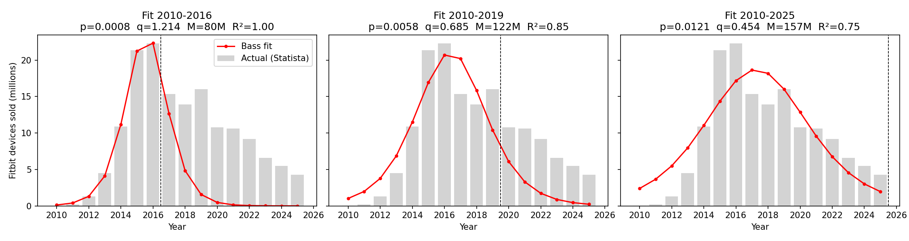

# Innovation Diffusion Analysis: Garmin Index Sleep Monitor

Lyudmila Zakaryan

## Step 1: The Chosen innovation
Garmin Index Sleep Monitor, from TIME's Best Inventions of 2025.
Link: https://time.com/collections/best-inventions-2025/

## Step 2: Look-alike innovation
Look-alike: Fitness trackers (Fitbit era).

-- Functionality and Technology
To analyze the Garmin Index Sleep Monitor, I am using early early-stage Fitbit wearable trackers (such as the original Fitbit Tracker and Fitbit One) as my historical benchmark. Functionally and technologically, both products share the same core value proposition: screenless, lightweight body sensors that capture passive biometric data and sync it wirelessly to a companion smartphone app for interpretation. The Garmin Index Sleep Monitor is worn on the upper arm to track sleep stages, heart rate variability, breathing variations, and skin temperature to generate a personalized sleep score and wake-up alarm. Similarly, early Fitbits recorded health metrics like daily steps, calories, and basic sleep patterns, transmitting the data to a central portal. Both devices rely on the seamless integration of non-intrusive hardware sensing and software analytics to give users actionable health insights.

-- Market Impact and Adoption Dynamics
From a market perspective, early Fitbit devices offer a clear historical precedent for how consumer health trackers diffuse. Fitbit drove rapid adoption partly through community features and social sharing, which created a strong peer-influence effect—directly mirroring the imitation coefficient (q) in the Bass diffusion model. However, while early Fitbits established the mass market for wearable activity trackers, the Garmin Index Sleep Monitor targets a more specialized niche. Priced at $169.99, it specifically solves the discomfort of wearing wristbands to bed for people who already track their health metrics. Because standalone activity trackers were eventually absorbed into general-purpose smartwatches, the Garmin Index functions as a targeted add-on device rather than a mass-market category creator. Consequently, while the diffusion curve will likely share a similar imitation pattern (q), its overall market potential (M) will be significantly smaller than that of early fitness wearables.

## Step 3: Historical data
(to be completed)

## Step 4: Bass model parameters
**Method.** 
I fitted the discrete Bass diffusion model to the yearly Fitbit sales
series (Statista, 2010–2025) using nonlinear least squares (scipy `curve_fit`).
In the model, sales in year t are M × [F(t) − F(t−1)], where
F(t) = (1 − e^(−(p+q)t)) / (1 + (q/p)·e^(−(p+q)t)), p is the coefficient of
innovation, q is the coefficient of imitation, and M is the market potential
(total units that will ever be sold). Code: `step4_estimate_bass.py`.

**Choice of fitting window.**
 Fitbit sales peaked in 2016 and then declined as
smartwatches replaced stand-alone trackers. The Bass model describes a product
that rises and fades on its own, so it cannot represent displacement by a
competing technology. I therefore tested three windows.

| Window | p | q | M (million units) | R² |
|---|---|---|---|---|
| 2010–2016 | 0.0008 | 1.214 | 80.4 | 0.9996 |
| 2010–2019 | 0.0058 | 0.686 | 122.2 | 0.853 |
| 2010–2025 | 0.0121 | 0.454 | 157.0 | 0.754 |

**Interpretation.** 
The 2010–2016 fit is almost perfect (R² ≈ 1) but estimates
three parameters from only seven observations, so the fit is nearly guaranteed
and the parameters are implausible (p = 0.0008, q = 1.21). It also predicts
sales falling to zero by 2019, which did not happen. The full-sample fit
(2010–2025) has weaker fit (R² = 0.75) because the real decline after 2016 was
slower than the model allows, but its parameters (p = 0.012, q = 0.454) are
close to the values typically reported in the diffusion literature. I use the
2010–2025 estimates as the main result and report the other two as robustness
checks.

With p = 0.012 and q = 0.454, imitation is about 37 times stronger than
independent adoption (q/p = 37.5). The model implies sales peak around 2017
and a market potential of about 157 million units.

**Limitation.** 
M counts units sold, not unique customers. Fitbit sales include
repeat purchases and replacements, so M overstates the number of distinct
adopters.

## Step 5: Predicted diffusion
(to be completed)

## Step 6: Scope
(to be completed)

## Step 7: Adopters by period
(to be completed)

## References
- TIME. (2025). The Best Inventions of 2025. https://time.com/collections/best-inventions-2025/
- Tom's Guide. Garmin launches first sleep-only tracker. https://www.tomsguide.com/wellness/sleep-tech/garmin-launches-new-index-sleep-monitor-for-screenless-sleep-tracking
- Wearable Technologies. Garmin Launches Sleep-Tracking Armband. https://wearable-technologies.com/cn/news/garmin-launches-sleep-tracking-armband
- Wareable. The story of Fitbit. https://www.wareable.com/fitbit/youre-fitbit-and-you-know-it-how-a-wooden-box-became-a-dollar-4-billion-company
- EBSCO Research Starters. Fitbit. https://www.ebsco.com/research-starters/technology/fitbit
- Wikipedia. Fitbit. https://en.wikipedia.org/wiki/Fitbit
- Vator. Fitbit's timeline. https://vator.tv/?p=37368