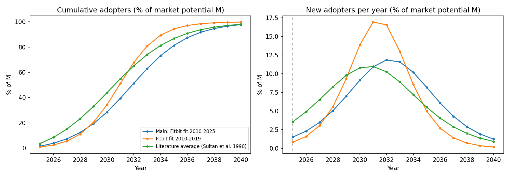
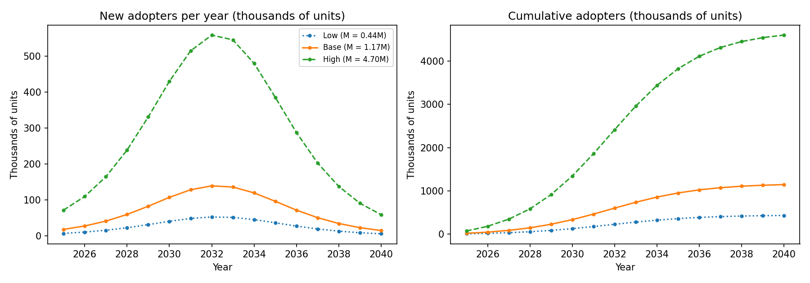

# Innovation Diffusion Analysis: Garmin Index Sleep Monitor

Lyudmila Zakaryan

## Step 1: The Chosen innovation
Garmin Index Sleep Monitor, from TIME's Best Inventions of 2025.
Link: https://time.com/collections/best-inventions-2025/

## Step 2: Look-alike innovation
Look-alike: Fitness trackers (Fitbit era).

-- Functionality and Technology
To analyze the Garmin Index Sleep Monitor, I am using early early-stage Fitbit wearable trackers (such as the original Fitbit Tracker and Fitbit One) as my historical benchmark. Functionally and technologically, both products share the same core value proposition: screenless, lightweight body sensors that capture passive biometric data and sync it wirelessly to a companion smartphone app for interpretation. The Garmin Index Sleep Monitor is worn on the upper arm to track sleep stages, heart rate variability, breathing variations, and skin temperature to generate a personalized sleep score and wake-up alarm. Similarly, early Fitbits recorded health metrics like daily steps, calories, and basic sleep patterns, transmitting the data to a central portal. Both devices rely on the seamless integration of non-intrusive hardware sensing and software analytics to give users actionable health insights.

-- Market Impact and Adoption Dynamics
From a market perspective, early Fitbit devices offer a clear historical precedent for how consumer health trackers diffuse. Fitbit drove rapid adoption partly through community features and social sharing, which created a strong peer-influence effect—directly mirroring the imitation coefficient (q) in the Bass diffusion model. However, while early Fitbits established the mass market for wearable activity trackers, the Garmin Index Sleep Monitor targets a more specialized niche. Priced at $169.99, it specifically solves the discomfort of wearing wristbands to bed for people who already track their health metrics. Because standalone activity trackers were eventually absorbed into general-purpose smartwatches, the Garmin Index functions as a targeted add-on device rather than a mass-market category creator. Consequently, while the diffusion curve will likely share a similar imitation pattern (q), its overall market potential (M) will be significantly smaller than that of early fitness wearables.

## Step 3: Historical data
(to be completed)

## Step 4: Bass model parameters
**Method.** 
I fitted the discrete Bass diffusion model to the yearly Fitbit sales
series (Statista, 2010–2025) using nonlinear least squares (scipy `curve_fit`).
In the model, sales in year t are M × [F(t) − F(t−1)], where
F(t) = (1 − e^(−(p+q)t)) / (1 + (q/p)·e^(−(p+q)t)), p is the coefficient of
innovation, q is the coefficient of imitation, and M is the market potential
(total units that will ever be sold). Code: `step4_estimate_bass.py`.

**Choice of fitting window.**
 Fitbit sales peaked in 2016 and then declined as
smartwatches replaced stand-alone trackers. The Bass model describes a product
that rises and fades on its own, so it cannot represent displacement by a
competing technology. I therefore tested three windows.

| Window | p | q | M (million units) | R² |
|---|---|---|---|---|
| 2010–2016 | 0.0008 | 1.214 | 80.4 | 0.9996 |
| 2010–2019 | 0.0058 | 0.686 | 122.2 | 0.853 |
| 2010–2025 | 0.0121 | 0.454 | 157.0 | 0.754 |

**Interpretation.** 
The 2010–2016 fit is almost perfect (R² ≈ 1) but estimates
three parameters from only seven observations, so the fit is nearly guaranteed
and the parameters are implausible (p = 0.0008, q = 1.21). It also predicts
sales falling to zero by 2019, which did not happen. The full-sample fit
(2010–2025) has weaker fit (R² = 0.75) because the real decline after 2016 was
slower than the model allows, its parameters (p = 0.012, q = 0.454) are close to the average values
reported in a meta-analysis of 213 diffusion studies (p = 0.03, q = 0.38;
Sultan, Farley and Lehmann, 1990). I use the
2010–2025 estimates as the main result and report the other two as robustness
checks.

With p = 0.012 and q = 0.454, imitation is about 37 times stronger than
independent adoption (q/p = 37.5). The model implies sales peak around 2017
and a market potential of about 157 million units.

**Limitation.** 
M counts units sold, not unique customers. Fitbit sales include
repeat purchases and replacements, so M overstates the number of distinct
adopters.

## Step 5: Predicted diffusion
**Method.**
 The Garmin Index Sleep Monitor has no sales history, so I apply
the Bass parameters estimated for the look-alike (Fitbit, 2010–2025:
p = 0.0121, q = 0.4542) to Garmin. Time t = 1 is the launch year: Garmin
launched the product on 18 June 2025 at a US price of $169.99 (Vice, 2025;
Tom's Guide, 2025), so 2025 is year 1. Because M (market potential) is
estimated separately in Step 7, the forecast here is expressed as a share
of M. Code: `step5_forecast_garmin.py`.

| Year | Cumulative adopters (% of M) | New adopters in year (% of M) |
|---|---|---|
| 2025 | 1.5% | 1.5% |
| 2027 | 7.3% | 3.5% |
| 2030 | 28.6% | 9.1% |
| 2032 | 51.4% | 11.9% |
| 2035 | 81.3% | 8.2% |
| 2037 | 91.7% | 4.3% |
| 2040 | 97.8% | 1.2% |

**Result.**
 Under the main scenario, annual adoption peaks in 2032 at about
11.9% of M, half of the market is reached in 2032 and 90% by 2037.

**Sensitivity.**
 To test how much the forecast depends on one set of
parameters, I repeated it with (a) the Fitbit fit on 2010–2019 data
(p = 0.0058, q = 0.686) and (b) the average parameters from a meta-analysis
of 213 diffusion studies (p = 0.03, q = 0.38; Sultan, Farley and Lehmann,
1990).

| Scenario | Peak year | 50% of M | 90% of M |
|---|---|---|---|
| Main: Fitbit 2010–2025 | 2032 | 2032 | 2037 |
| Fitbit 2010–2019 | 2031 | 2031 | 2035 |
| Literature average | 2031 | 2031 | 2036 |

The timing of the peak is stable across scenarios (2031–2032), which gives
confidence in the shape of the curve.

**Limitations.**
 The look-alike assumption is the main one. Fitbit was a
stand-alone wrist tracker, while the Index Sleep Monitor is a niche
accessory that works best alongside a Garmin watch, so its adoption could be
slower or tied to Garmin's existing customer base. The first period is also
only a partial year (the launch was in June). The forecast gives the shape
of diffusion; the number of adopters depends on M, estimated in Step 7.

## Step 6: Scope
**Decision.** I analyse the diffusion of the Garmin Index Sleep Monitor
**worldwide**. The choice rests on four points.

1. **The look-alike data is global.**
 The Fitbit series used to estimate the
   Bass parameters counts devices sold worldwide (Statista, 2026; Fitbit, 2016,
   2020). The estimated p and q therefore describe global diffusion, and
   applying them to one country would mix two different scales.

2. **Garmin is a global business without a dominant country.** 
Garmin reported
   net sales of $7.25 billion in fiscal 2025, of which about 48% came from the
   Americas, 38% from EMEA and 14% from APAC (Garmin, 2026). The largest region
   is below half of sales, and "Americas" covers more than the United States,
   so a single-country analysis would cover well under half of Garmin's market.

3. **The product was launched in many markets.** 
The Index Sleep Monitor was
   priced at $169.99 in the United States and £149.99 in the United Kingdom
   (Tom's Guide, 2025), €169.99 in Europe (TechRadar, 2025) and ₱10,290 in
   the Philippines (TechPorn, 2025).

4. **Global data is available for the estimates in Step 7.** 
For example, IDC reports that 145.7 million wearable devices were shipped worldwide in the first quarter of 2026 (IDC, 2026).
 Consistent country-level data would be harder to source, and
   every number in this analysis needs a credible reference.

**Limitations.**
However, a global scope hides differences between countries. Adoption
speed and market conditions vary by region; for example, IDC reports that
government subsidies pushed China's wrist-worn device shipments up 36.9%
in 2025, far above the global growth rate (IDC, 2025). The global forecast
should therefore be read as an average across markets. As an extension, the
global number of adopters could be split by region using Garmin's regional
revenue shares.

## Step 7: Adopters by period
**Method.** Step 7 has two parts. First, I estimate the market potential M
with a Fermi calculation. Second, I multiply M by the diffusion shape from
Step 5 (p = 0.0121, q = 0.4542, t = 1 in 2025), so that adopters in year t
equal M × [F(t) − F(t−1)]. One adopter means one band sold. Code:
`step7_estimate_adopters.py`.

**Fermi estimate of M.** M = Garmin users × share who track sleep × share
who buy a dedicated band.

| Layer | Low | Base | High | Source |
|---|---|---|---|---|
| Active Garmin Connect users worldwide (millions) | 42 | 45 | 49 | the5krunner (2026) |
| Share of users who track sleep | 21% | 26% | 50% | Low: CCS Insight, cited in Raconteur (2016); Base: Rock Health (2025); High: JMIR Preprints |
| Share of those who buy a separate band | 5% | 10% | 20% | Assumption of this report |
| **M (million units)** | **0.44** | **1.17** | **4.9** | Product of the layers |

The target group is Garmin users, because Garmin markets the band to people
who wear a Garmin device during the day (Best Buy, 2025). Non-Garmin buyers
are excluded, so M is conservative. Garmin does not publish a Connect user
count; the5krunner's estimate is the only available figure and is treated as
an estimate. The share who buy a band has no source: buying a second
$169.99 device is a much smaller group than users who track sleep, so I
assume 10% and test 5% and 20%. The Rock Health share comes from a US survey
and the JMIR share from a sample of health-technology employees, so the high
case is an upper bound.

As a plausibility check, the base-case M of 1.17 million units equals about
5.7% of the 20.7 million units Garmin shipped in 2025 (Garmin, 2026), and the
peak of about 139 thousand units a year is small next to the 4.9 million
smart rings IDC forecasts for 2026 (IDC, 2026), consistent with a niche
accessory.

**Adopters by year (base case, thousands of units).**

| Year | New adopters | Cumulative adopters |
|---|---|---|
| 2025 | 17.8 | 17.8 |
| 2027 | 40.8 | 85.8 |
| 2030 | 106.9 | 334.2 |
| 2032 | 138.8 | 600.9 |
| 2035 | 95.8 | 951.6 |
| 2037 | 50.4 | 1,073.4 |
| 2040 | 14.6 | 1,144.6 |

| Scenario | M (million) | Peak-year new adopters (thousands, 2032) | Cumulative by 2040 (thousands) |
|---|---|---|---|
| Low | 0.44 | 52 | 431 |
| Base | 1.17 | 139 | 1,145 |
| High | 4.90 | 581 | 4,794 |

**Interpretation.** In the base case about 600 thousand bands are sold by
2032, when annual sales peak, and about 1.14 million by 2040. The timing is
fixed by the Bass parameters; the size depends on M, which varies about
eleven-fold between the low and high cases. The share who buy a band is the
largest source of that spread.

**Limitations.** (1) The share who buy a band is an assumption. (2) The
number of Garmin users is an external estimate. (3) The survey shares come
from different samples, mostly in the United States, and are applied
worldwide. (4) M is fixed, although Garmin's user base is growing, which
would raise M over time. (5) The first period is a partial year (launch in
June 2025). (6) M counts units sold, not distinct people.

## References
- TIME. (2025). The Best Inventions of 2025. https://time.com/collections/best-inventions-2025/
- Tom's Guide. Garmin launches first sleep-only tracker. https://www.tomsguide.com/wellness/sleep-tech/garmin-launches-new-index-sleep-monitor-for-screenless-sleep-tracking
- Wearable Technologies. Garmin Launches Sleep-Tracking Armband. https://wearable-technologies.com/cn/news/garmin-launches-sleep-tracking-armband
- Wareable. The story of Fitbit. https://www.wareable.com/fitbit/youre-fitbit-and-you-know-it-how-a-wooden-box-became-a-dollar-4-billion-company
- EBSCO Research Starters. Fitbit. https://www.ebsco.com/research-starters/technology/fitbit
- Wikipedia. Fitbit. https://en.wikipedia.org/wiki/Fitbit
- Vator. Fitbit's timeline. https://vator.tv/?p=37368
- Bass, F. M. (1969). A new product growth for model consumer durables. Management Science, 15(5), 215–227.
- Sultan, F., Farley, J. U., & Lehmann, D. R. (1990). A meta-analysis of applications of diffusion models. Journal of Marketing Research, 27(1), 70–77.
- Tom's Guide (2025). Garmin launches first sleep-only tracker. https://www.tomsguide.com/wellness/sleep-tech/garmin-launches-new-index-sleep-monitor-for-screenless-sleep-tracking
- Vice (2025). Hate wearing your smartwatch to bed to track your sleep? Garmin's got a new fix. https://www.garmin.com/en-US/newsroom/press-release/sports-fitness/rest-easy-with-the-index-sleep-monitor-smart-sleep-band-from-garmin/
- Garmin sleep trachink; https://support.garmin.com/en-US/?faq=mBRMf4ks7XAQ03qtsbI8J6
- Garmin Ltd. (2026). Annual Report on Form 10-K for fiscal year 2025. U.S. SEC. https://www.sec.gov/Archives/edgar/data/1121788/000119312526056028/grmn-20251227.htm
- IDC (2026). Wearable Devices Market Insights, 2026Q1 (updated 2 July 2026). https://www.idc.com/promo/wearablevendor/
- IDC (2025). Global Wrist-Worn Device Shipments Grew 10.5% in Q1 2025. https://www.idc.com/resource-center/press-releases/idc-global-wrist-worn-device-shipments-grew-10-5-in-q1-2025/
- TechPorn (2025). Garmin launches Index Sleep Monitor upper-arm band. https://www.techporn.ph/garmin-launches-index-sleep-monitor-upper-arm-band/
- TechRadar (2025). Garmin heeft de Index Sleep Monitor gelanceerd. https://global.techradar.com/nl-nl/health-fitness/sleep/garmin-heeft-de-index-sleep-monitor-gelanceerd-en-dit-zijn-9-dingen-die-je-erover-moet-weten
